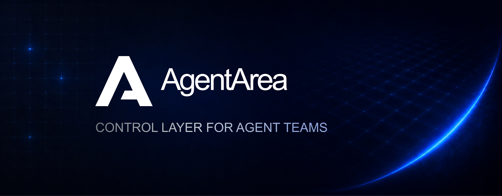
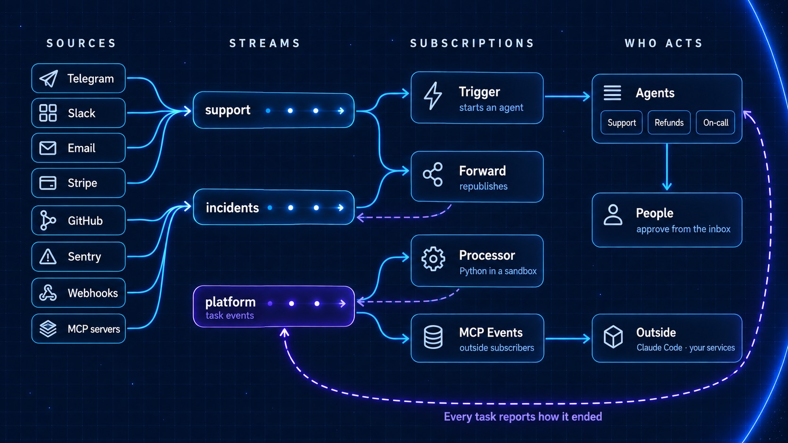
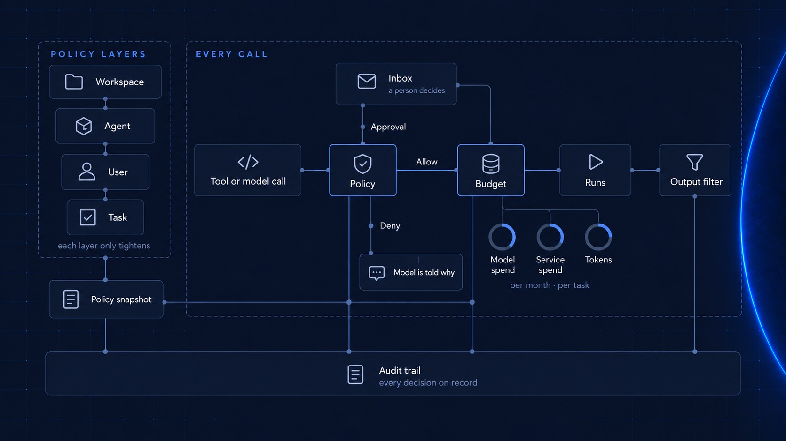
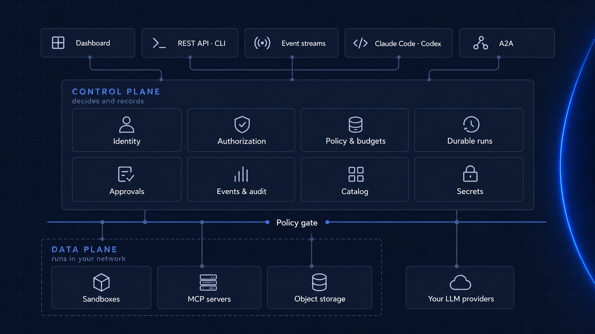

<div align="center">



# Build an organization where agents do the work

AgentArea is an open-source platform for agent-native organizations: teams where AI
agents hold real roles, take work from the same channels people do, hand work to each
other, and answer to the people who run the organization.

[](LICENSE.md)
[](https://github.com/agentarea/agentarea/actions/workflows/ci.yml)
[](https://github.com/agentarea/agentarea/releases)
[](https://docs.agentarea.ai)
[](https://discord.gg/5tduPwheYQ)

[How you build one](#how-you-build-an-agent-organization) · [How work flows](#how-work-moves-through-the-organization) · [Quickstart](#quickstart) · [What's inside](#whats-inside) · [Rules](#every-call-answers-to-the-rules) · [Architecture](#architecture) · [Deploy](#deploy) · [Docs](https://docs.agentarea.ai)

</div>

## How you build an agent organization

**1. Hire.** An agent is a role: instructions, a model, and the tools and skills the
job needs. Tools are MCP servers that AgentArea hosts for you or that you already run.

**2. Wire in the work.** Point Telegram, email, Slack, GitHub, Stripe or Sentry at an
event stream. A trigger on the stream hands each matching event to the right agent:
one task per event, one per conversation, or one per batch. Schedules cover the rest.

**3. Set the rules.** Which tools each agent may call, which calls wait for a person's
approval, how much each agent may spend in a month or in a single task. Rules are
data, and they are checked before every model call and tool call.

**4. Let them work together.** An agent hands part of its task to another agent and
waits for the result. Every task that finishes, fails or stops for approval becomes
an event the rest of the organization can react to. People step in from their inbox,
in the dashboard or from Claude Code.

<!-- images/readme/network.png: the Network tab of a demo organization goes here -->

### The whole organization is one file

A **bundle** describes a working setup: agents, their MCP servers and skills, the
channels and schedules that feed them, and the policies they answer to. Install it into
any workspace; export your workspace as one. Credentials never travel in the file.

```yaml
schema_version: "0.1.0"
name: support-desk

setup:
  - { key: model, label: Model, type: string, required: true }
  - { key: stripe_key, label: Stripe restricted key, type: secret, required: true }
  - { key: telegram_token, label: Telegram bot token, type: secret, required: true }

mcps:
  - key: stripe
    name: Stripe
    json_spec: { type: url, endpoint_url: https://mcp.stripe.com }
    bindings: { Authorization: "Bearer ${setup.stripe_key}" }

agents:
  - key: support
    name: Support
    model: ${setup.model}
    instruction: Answer customers, look up their payments, refund when the policy allows it.
    mcps: [stripe]
  - key: analyst
    name: Support analyst
    model: ${setup.model}
    instruction: Read the week's conversations and refunds, report what keeps going wrong.
    toolsets: [agentarea/stream_events]

channels:                      # customers write to a Telegram bot, Support answers
  - key: support_bot
    type: telegram
    name: Customer support bot
    agent: support
    bindings: { bot_token: "${setup.telegram_token}" }

automations:                   # every Monday the analyst writes a report
  - key: weekly_report
    cron: "0 9 * * MON"
    agent: analyst
    prompt: Write last week's support report.

policies:
  - key: refunds_need_a_person # the run pauses until someone approves the refund
    subject: support
    target: tool:create_refund
    effect: approval
  - key: support_budget
    subject: support
    target: spend
    effect: cap
    params: { amount_usd: 200, period: month }
```

The installer shows what it will create before it writes anything, installs in
dependency order, and removes everything it created if a step fails. Channels and
schedules install switched off until you have checked their credentials.
[Bundles →](https://docs.agentarea.ai/concepts/integration/bundles)

## How work moves through the organization

<p align="center">
  
</p>

- **Sources** write into **streams** you name: `support`, `incidents`, `sales`. The
  catalog has sources for generic webhooks, GitHub, Slack, Telegram, Linear, Discord,
  Stripe, Sentry, Gmail, Teams, email, IMAP, RSS, and any MCP server that offers events.
  Each request is verified, deduplicated and kept in one envelope.
- **Subscriptions** take events out, each with its own filter. A **trigger** starts an
  agent, and with `session` the next message of the same conversation joins the running
  task instead of starting a new one. A **forward** republishes events into other
  streams. A **processor**, Python that an agent writes and the platform runs in a
  sandbox, turns each event into new events in other streams. **MCP Events** delivers a stream to Claude Code or your own service, by
  polling or by signed webhooks.
- **The platform stream** is how the organization hears about its own work:
  `task.completed`, `task.failed`, `approval.requested`. Put an on-call agent on
  `task.failed`, or a reporting agent on `task.completed`. Every event carries the event
  that caused it, and chains stop at a depth limit, so agents cannot wake each other forever.
- **The events page** shows every event and what each subscription did with it: which
  task it started, why it was skipped, where it failed.

[Event streams →](https://docs.agentarea.ai/concepts/integration/event-streams)

## Quickstart

You need Docker with Docker Compose.

```bash
curl -fsSL https://raw.githubusercontent.com/agentarea/agentarea/main/scripts/install.sh | sh
```

The installer downloads the runtime bundle into `./agentarea`, generates the
credentials the stack needs, and offers to start it. It does not clone the repository
or install anything else. From then on it is plain `docker compose` in that directory.

Then, at **http://localhost:3000**:

1. Add a model provider key under **Models**.
2. Create an agent and give it a tool.
3. Under **Policies**, set that tool to *requires approval*.
4. Start a task that needs the tool. The run pauses. Approve it in **Inbox** and watch
   it finish.

Full walkthrough: [Quickstart](https://docs.agentarea.ai/quickstart). For Kubernetes,
see [Deploy](#deploy).

## What's inside

<details open>
<summary><b>Agents and the organization</b></summary>

- **Workspaces** are isolated organizations: members, agents, tools, policies, budget.
  **Projects** inside them group agents, MCP servers and skills, with access granted per person.
- **Delegation.** An agent gets one `delegate_to_<agent>` tool per colleague. Inside the
  platform it is a direct call; to an agent in another workspace or on another server it
  goes over [A2A](https://docs.agentarea.ai/concepts/agents/a2a). The model never sees the difference.
- **Skills** are folders of instructions and files an agent loads only when a task needs
  them. Import them from GitHub, or point the workspace at a [skill registry](https://docs.agentarea.ai/guides/agents/add-a-skill-registry).
- **Catalog and registries.** MCP servers, skills and bundles come from registries with a
  scope and a trust level. An install pins a version, and policy decides which registries
  members may install from. [Registry and catalog →](https://docs.agentarea.ai/concepts/integration/registry-and-catalog)
- **Bundles** describe a whole setup in one file and install it in one step, as shown above.
- **Models.** Any OpenAI-compatible provider, chosen per agent. Image and video models
  are available to agents as tools.
- **Context strategies.** Static, hybrid or dynamic: large tool outputs go to storage
  and come back as a handle, long histories are compacted, tools are disclosed lazily.
  [Context strategies →](https://docs.agentarea.ai/concepts/agents/context-strategies)

</details>

<details>
<summary><b>MCP, from both sides</b></summary>

- **Hosted MCP servers** from a container image or straight from an npm or PyPI package.
  [Add a hosted server →](https://docs.agentarea.ai/guides/mcp/add-a-hosted-server)
- **Remote MCP servers** with OAuth: discovery and PKCE, tokens stored and refreshed by
  the platform. [OAuth →](https://docs.agentarea.ai/guides/mcp/authenticate-with-oauth)
- **Serverless MCP.** An idle server is reclaimed and the next call starts it again, with
  its connection, credentials and tools unchanged. On by default.
  [Serverless MCP →](https://docs.agentarea.ai/self-host/serverless-mcp)
- **Secrets by declaration.** A server's `env_schema` says which inputs are credentials;
  their values go to the secret manager and are resolved at call time.
- **One endpoint per harness.** Register Claude Code, Codex or Cursor as a client, attach
  MCP servers, OpenAPI connections, platform toolsets and skills, and it gets one MCP URL
  with the workspace's policy on every call.
  [Combine servers behind one endpoint →](https://docs.agentarea.ai/guides/mcp/build-a-compound-mcp)
- **AgentArea is an MCP server itself.** Create agents, start and steer runs, resolve
  approvals and wire triggers from your editor, at `/mcp` or pinned to one workspace at
  `/mcp/w/{workspace}`. [Connect a harness →](https://docs.agentarea.ai/guides/mcp/connect-a-harness-to-agentarea)
- **Your app's tools for agents**, with a signed context token on every call that says
  which end user, task and agent it is for. [Expose your app's tools →](https://docs.agentarea.ai/guides/mcp/expose-your-app-tools)
- **Metered tools.** A connector declares what a call costs, and it counts against the
  same spend caps as model calls. [Tool costs →](https://docs.agentarea.ai/reference/tool-costs)

</details>

<details>
<summary><b>Sandboxes and files</b></summary>

- **One sandbox per task.** Successive commands see the same filesystem and processes.
  Sandboxes come up from a warm pool and are reclaimed when the task ends.
  [Sandbox sessions →](https://docs.agentarea.ai/concepts/sandbox/sessions)
- **Providers:** Docker, Kubernetes, E2B, OpenSandbox, Cube. On Kubernetes, sandboxes and
  MCP servers can run under gVisor. [Isolation →](https://docs.agentarea.ai/concepts/sandbox/isolation)
- **Files in, artifacts out.** Attach files to a task and the agent finds them in its
  sandbox. What it produces is stored content-addressed and verified before download.
  [Artifacts →](https://docs.agentarea.ai/concepts/execution/artifacts)

</details>

<details>
<summary><b>Events, triggers and channels</b></summary>

- **Event streams** with sources from the catalog and subscriptions with filters, as
  described [above](#how-work-moves-through-the-organization).
- **Triggers** per event, per conversation or per batch; **cron** schedules; **saved
  tasks** you can run on demand or point a trigger at.
- **Channels** answer where the request came from: a Telegram chat, an email thread.
- **Live task events** over SSE, with the durable history behind them, so a client that
  attaches late misses nothing. [Stream task events →](https://docs.agentarea.ai/guides/tasks/stream-events)

</details>

<details>
<summary><b>Identity, access and governance</b></summary>

- **Identity:** people through Ory Kratos, MCP clients through OAuth on Ory Hydra, and
  scoped API keys you can rotate and revoke.
- **ReBAC authorization** on OpenFGA: who manages which project, which project contains
  which agent. Checks fail closed, and you can add your own relations.
  [Authorization model →](https://docs.agentarea.ai/concepts/governance/the-agentarea-model)
- **Policies** layered from workspace to agent to user to task, where a lower layer can
  only tighten a higher one, compiled into one snapshot per task.
  [Policy engine →](https://docs.agentarea.ai/concepts/governance/policy-engine)
- **Approvals** as a workflow state: the run suspends, holds no connection, survives
  restarts, and resumes on the approver's decision.
- **Budgets** in three dimensions: model spend, paid tool and service spend (including
  agent wallet payments over x402 and MPP), and tokens.
  [Set a budget →](https://docs.agentarea.ai/guides/governance/set-a-budget)
- **Audit:** an append-only log of control-plane changes with field-level diffs, and
  the event history of every run. [Audit →](https://docs.agentarea.ai/concepts/governance/audit)
- **Cost per end user.** Read what each task cost, attributed to your own customer, to
  bill them for it. [Charge for task cost →](https://docs.agentarea.ai/guides/tasks/charge-for-task-cost)

</details>

<details>
<summary><b>Durable execution</b></summary>

- **Every task is a Temporal workflow.** A crash or a deploy mid-task does not lose
  work; finished model and tool calls are not repeated.
  [Durable execution →](https://docs.agentarea.ai/concepts/execution/durable-execution)
- **Pause, resume, cancel.** Give a task that hit its limit more budget or more
  iterations and let it continue. [Cancel and retry →](https://docs.agentarea.ai/guides/tasks/cancel-and-retry)
- **Failures you can read:** a failure code, a per-task rollup, and the exact event that
  broke the run. [Debug a failed task →](https://docs.agentarea.ai/guides/tasks/debug-a-failed-task)

</details>

## Every call answers to the rules

<p align="center">
  
</p>

- **Rules come in four layers:** workspace, agent, user, task. A lower layer can only
  tighten a higher one, so a task can get a smaller budget than its agent but never a
  bigger one. When a task starts, the layers compile into one policy snapshot that every
  check in the run reads.
- **The policy decides each call:** allow, deny, or approval. A denied call does not
  kill the run; the model is told why and carries on. The same decision guards every
  path a call can take: the agent loop, delegation, skills, and outside MCP clients.
- **Approval is a pause, not a timeout.** The run suspends and holds nothing open. A
  named person decides from the inbox or from Claude Code, and the run resumes, hours
  later if need be.
- **Budgets are checked before the money is spent:** model spend, paid tool and service
  spend, and tokens, capped per month and per task. Every new workspace starts with $500
  a month, $50 per task, a token ceiling, and prompt-injection and output filters on.
- **Every decision is on record:** who allowed what, which call was denied, who approved
  it, and what it cost.

Rules are data, written in the dashboard, through
`/v1/workspaces/{workspace}/policies`, or in a bundle. These two deny one tool to one
agent and put another behind a named approver:

```json
[
  { "subject_type": "agent", "subject_id": "3f9c1e42-…", "target": "tool:send_email",    "effect": "deny" },
  { "subject_type": "agent", "subject_id": "3f9c1e42-…", "target": "tool:refund_payment", "effect": "approval",
    "params": { "approvers": ["user:alice@example.com"] } }
]
```

The [policy reference](https://docs.agentarea.ai/reference/policy-syntax) lists every
effect and says which combinations are enforced today.
[How it works](https://docs.agentarea.ai/how-it-works) follows one request through every
service.

## Architecture

<p align="center">
  
</p>

The **control plane** decides and records. The **data plane** executes, touches your
data, and can run in a network of its own: the control plane is never told a pod name,
and a data-plane host never holds a database credential.
[Control plane and data plane →](https://docs.agentarea.ai/concepts/control-and-data-plane)

| Component | What it does |
|---|---|
| **API** (Python, FastAPI) | Authentication, authorization and CRUD. Resolves policy and starts runs. Receives webhooks, relays events over SSE, serves MCP at `/mcp`. |
| **Worker** (Python, Temporal) | Runs the agent loop and the governance gates around each call. |
| **MCP manager** (Go) | Starts, wakes and reclaims sandboxes and hosted MCP servers on Docker or Kubernetes, or hands sandboxes to an external provider. |
| **Event service** (Go) | Polls sources, runs schedules and chat channels, and turns what they produce into events and tasks. |
| **Dashboard** (Next.js) | Agents, network, runs, inbox, events, policies, budgets, catalog, audit. |
| **Backing services** | PostgreSQL, Valkey, S3-compatible storage, Temporal, OpenFGA, Ory Kratos and Hydra. |

## Deploy

Pick the shape that fits, from a laptop to a control plane whose execution runs in
someone else's network:

| Shape | How |
|---|---|
| **Try it on one machine** | `install.sh`, then Docker Compose. [Docker Compose →](https://docs.agentarea.ai/self-host/docker-compose) |
| **One Kubernetes cluster** | The `agentarea` Helm chart, with every dependency bundled or brought by you. |
| **Execution in a separate cluster** | `agentarea` for the control plane, `agentarea-dataplane` in the execution cluster: the data-plane API for MCP servers, optionally OpenSandbox for agent sandboxes, and the namespaces, admission and network policy that confine both. |
| **MCP servers on a host of their own** | The same image in data-plane mode, under gVisor, with no database, Redis or secret-manager credentials on the host. [MCP on a dedicated host →](https://docs.agentarea.ai/self-host/mcp-data-plane) |

### Helm

```bash
helm repo add agentarea https://agentarea.github.io/helm-charts
helm repo update
helm install agentarea agentarea/agentarea --namespace agentarea --create-namespace -f values.yaml
```

The chart brings PostgreSQL, Valkey, RustFS, Temporal, Kratos and OpenFGA, so a default
install works on an empty cluster. For anything you intend to keep, bring your own
state and confine untrusted code:

```yaml
# values.yaml
postgresql: { enabled: false }
redis: { enabled: false }
rustfs: { enabled: false }

global:
  database: { host: postgres.internal.example.com, port: 5432, name: agentarea, sslMode: require }
  redis: { existingSecret: agentarea-redis-url }
  storage:
    type: s3
    endpoint: https://s3.us-east-1.amazonaws.com
    publicEndpoint: https://s3.us-east-1.amazonaws.com
    bucket: agentarea-documents
    region: us-east-1

mcpManager:
  runtimeClass: gvisor          # sandboxes and MCP servers get their own kernel
  serverless: { enabled: true } # idle MCP servers are reclaimed (the default)
```

[Deploy on Kubernetes](https://docs.agentarea.ai/self-host/kubernetes) walks through
the install, external databases and sizing.

### Running it

- **Secrets:** workspace secrets in the database or in [Infisical](https://docs.agentarea.ai/self-host/secrets-backends); deployment secrets in Kubernetes Secrets.
- **Networking:** ingress, public URLs and egress restrictions for untrusted pods. [Networking →](https://docs.agentarea.ai/self-host/networking)
- **Observability:** structured JSON logs and OpenTelemetry traces. [Observability →](https://docs.agentarea.ai/self-host/observability)
- **Day two:** [migrations](https://docs.agentarea.ai/self-host/database-and-migrations), [upgrades](https://docs.agentarea.ai/self-host/upgrades), [backup and restore](https://docs.agentarea.ai/self-host/backup-and-recovery), [troubleshooting](https://docs.agentarea.ai/self-host/troubleshooting).

Requirements for each target: [Requirements](https://docs.agentarea.ai/self-host/requirements).

## Use it from Claude Code, Codex or Cursor

```bash
claude mcp add --transport http agentarea http://localhost:8000/mcp/w/my-workspace \
  --header "Authorization: Bearer $AGENTAREA_TOKEN"
```

From there your editor can create agents, start and watch runs, read events, and
approve what is waiting in your inbox. Clients that support OAuth can sign in instead
of using a key. To give a harness your company's MCP servers rather than the platform's
own tools, register it as a client and use its endpoint, `/mcp/clients/{id}`.

## Is it for you

AgentArea is worth its weight if:

- Your agents call tools that **change things**: send mail, move money, write to
  production, open pull requests.
- **Someone other than the agent's author** has to be able to say "not without asking me first".
- Runs take **minutes or hours**, and a deploy or a crash must not lose them.
- You need to answer **"who allowed this, and when?"** after the fact.
- Several people or teams share agents, MCP servers and skills, and **must not see each other's**.

If you run one agent for yourself, you do not need this. Use Claude Code.

| | |
|---|---|
| **Not an agent framework.** | It does not tell you how to write the loop. It runs the loop and governs what the loop may do. |
| **Not a workflow builder.** | There is no drag-and-drop pipeline. An agent decides its own steps, and policy decides which steps are allowed. |
| **Not an LLM gateway.** | It governs tool calls and runs, not only model traffic. Point a model provider at your gateway if you have one. |
| **Not small.** | It is several services, a database, a workflow engine and an authorization server. That is the cost of the guarantees above. |

## Status and limitations

AgentArea is pre-1.0. These are known gaps, and the docs name more:

- Policy `condition` fields and `group` subjects are stored but not evaluated yet.
- Sandbox isolation tiers, such as gVisor for untrusted code, exist but are not assigned by default.
- Container egress rules are declared but not enforced in core.

Where the documentation and the code disagree, the code is right and the page is a bug.

## Open core

Everything needed to run governed agents on your own infrastructure is in this
repository, under Apache 2.0. Commercial features ship as a separately installed
package that plugs into named extension points. It is not a fork.

| In this repository | Commercial package |
|---|---|
| Agent execution, tasks, Temporal workflows | Plan entitlements |
| Sandboxes and MCP hosting | Usage metering and billing |
| ReBAC authorization (OpenFGA) | Forwarding audit to a SIEM |
| Policies, budgets, approvals, audit in the database | Container egress enforcement |

[Open core](https://docs.agentarea.ai/concepts/open-core) explains where the line is and why.

## Repository

```
agentarea-platform/      API, Temporal worker, domain libraries (Python)
agentarea-webapp/        Dashboard (Next.js)
agentarea-mcp-manager/   Sandbox and MCP server orchestration (Go)
agentarea-event-service/ Sources, schedules and channels (Go)
agentarea-operator/      Kubernetes operator: catalog sync, LLM provider configs
agentarea-cli/           Terminal client (Node.js)
charts/                  Helm charts: agentarea, agentarea-dataplane
examples/                Bundles and deployment examples
docs/                    Source for docs.agentarea.ai
```

To work on AgentArea itself, clone the repository and run `make up-dev`, which builds
images from your working tree. [CONTRIBUTING.md](CONTRIBUTING.md) covers the rest.

## Community and license

- [Discord](https://discord.gg/5tduPwheYQ) for questions
- [Issues](https://github.com/agentarea/agentarea/issues) for bugs and feature requests
- [SECURITY.md](SECURITY.md) for reporting vulnerabilities privately
- [Code of Conduct](CODE_OF_CONDUCT.md)

Apache License 2.0. See [LICENSE.md](LICENSE.md).
